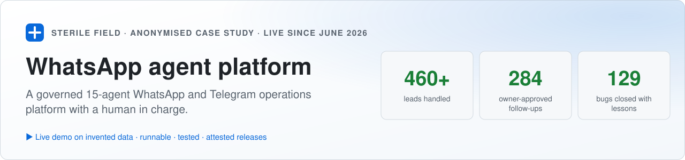
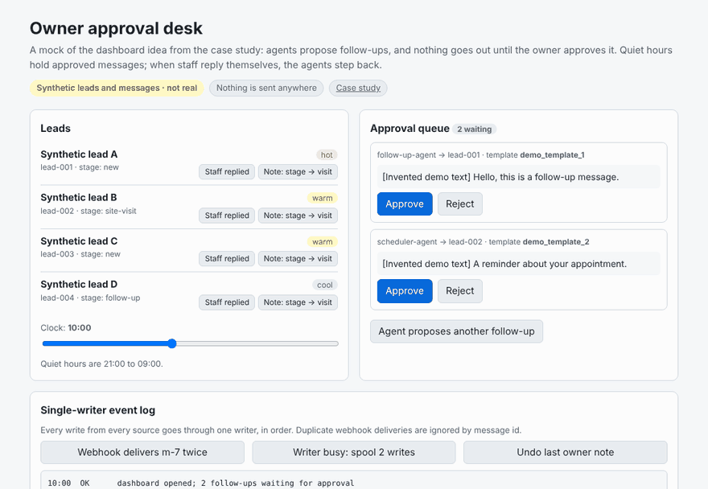
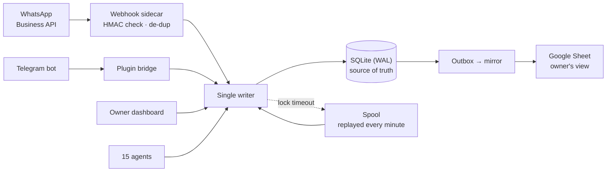
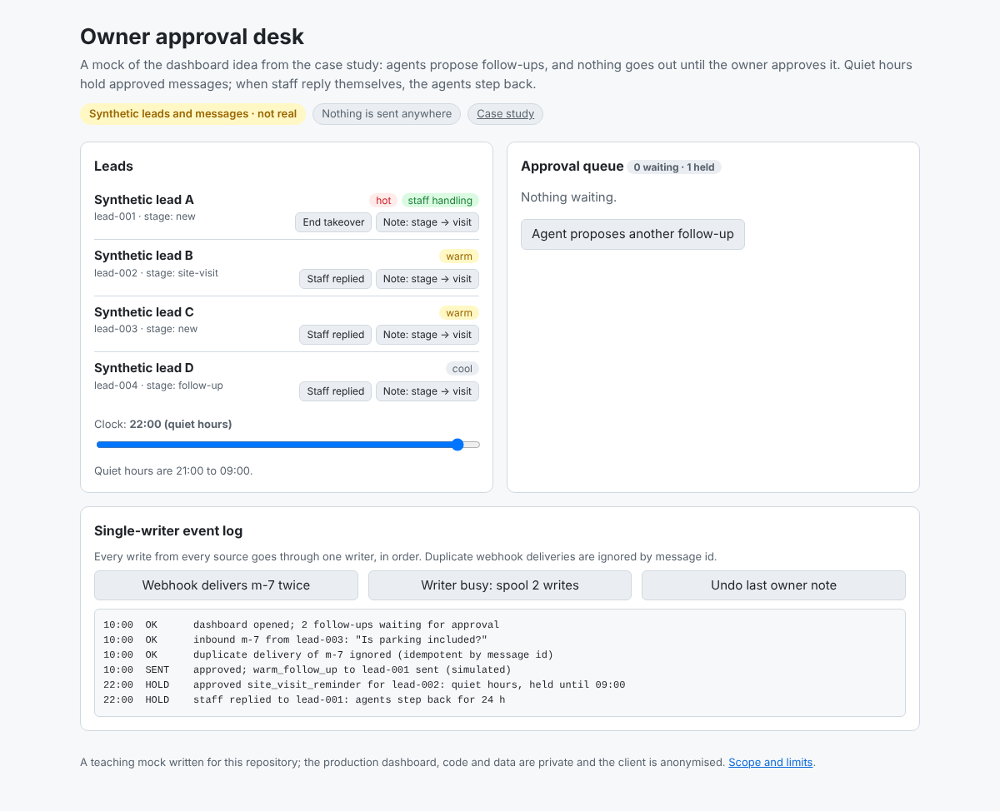

<p align="center"><a href="https://sterilefield.github.io/whatsapp-agent-case-study/"><picture>
  <source media="(prefers-color-scheme: dark)" srcset="docs/img/hero-dark.svg">
  
</picture></a></p>

# WhatsApp agent case study

**A 15-agent WhatsApp and Telegram operations platform for a Hyderabad real-estate brokerage: how it was built to recover missed enquiries, keep a human in charge, and run AI at almost no marginal cost.**

Live since June 2026. Designed, built and operated by one architect directing AI coding agents. The client is anonymised; no customer data, code, prompts or configuration are published here. Figures are shared with the client's permission.

> [!IMPORTANT]
> **Status:** Anonymised case study of a live client system (in production since June 2026). Last verified 21 Oct 2026. Not for clinical use as-is. Scope and limits: [TRUST.md](TRUST.md).

**[Architecture](docs/architecture.md) · [Human in charge](docs/human-in-charge.md) · [Agents and cost](docs/agents-and-cost.md) · [Lessons](docs/lessons.md) · [Trust](TRUST.md) · [All showcases](https://github.com/sterilefield) · [Contact](https://www.linkedin.com/in/dr-ravi-teja-thiriveedhi)**

[](https://github.com/sterilefield/whatsapp-agent-case-study/actions/workflows/ci.yml) [](https://sterilefield.github.io/whatsapp-agent-case-study/) [](https://codespaces.new/sterilefield/whatsapp-agent-case-study) [](https://scorecard.dev/viewer/?uri=github.com/sterilefield/whatsapp-agent-case-study) [](https://github.com/sterilefield/whatsapp-agent-case-study/releases/latest) [](#verify-this-release)

### See it in action

<a href="https://sterilefield.github.io/whatsapp-agent-case-study/"></a>

<sub>Recorded from the live demo page with scripted clicks, on invented data. [Open the demo](https://sterilefield.github.io/whatsapp-agent-case-study/) to try it yourself.</sub>

## Results

| Measure | Value |
|---|---|
| Leads handled | 460+ |
| Customer interactions logged | 8,688 |
| WhatsApp template follow-ups | 284 in 4 weeks, **each approved by the owner** in the dashboard |
| Owner time saved | 7+ hours a week (client-confirmed) |
| Heartbeat tokens | 12.0 M → 1.0 M a day (−91 %) |
| Extraction cost per WhatsApp message | ~38 k → ~4 k tokens (1,177 turns, 0 errors) |
| Marginal API cost per lead | ₹0 (≈ ₹13 at list price) |
| Tokens served from cache | 76–79 % |
| Bugs closed | 129, each with root cause, fix and lesson |

The platform is presented as **delivered and operating**. It is not claimed to have driven sales.

## The design in one picture



Three ideas carry the system:

1. **One writer, one source of truth.** Every write from every channel, agent and screen goes through a single writer into SQLite. The spreadsheet the owner likes is a mirror, never the database. See [docs/architecture.md](docs/architecture.md).
2. **A human stays in charge.** Behaviour lives in a policy file, not in code: reply rules, follow-up cadence, quiet hours and which messages may go out without a person. Template follow-ups go out only after the owner approves them. See [docs/human-in-charge.md](docs/human-in-charge.md).
3. **AI only where it earns its cost.** Rules first, a small single-purpose model for extraction, a top-tier model only for live intake, and plain code for monitoring. See [docs/agents-and-cost.md](docs/agents-and-cost.md).

## Read more

| Document | What it covers |
|---|---|
| [docs/architecture.md](docs/architecture.md) | Data flow, single-writer spine, safety net, recovery, client-node trust |
| [docs/human-in-charge.md](docs/human-in-charge.md) | Engagement policy, approvals, takeover, undo |
| [docs/agents-and-cost.md](docs/agents-and-cost.md) | 15 agents on 3 model tiers, and how token spend was cut |
| [docs/lessons.md](docs/lessons.md) | Engineering lessons from 129 bugs, grouped |
| [docs/timeline.md](docs/timeline.md) | From first commit to a live 15-agent platform |

## Related

- [llm-token-economics](https://github.com/sterilefield/llm-token-economics): the 18 cost methods behind the −91 %.
- [agent-governance-kit](https://github.com/sterilefield/agent-governance-kit): autonomy levels, risk classes and approval tiers.
- [empire-os-reference-architecture](https://github.com/sterilefield/empire-os-reference-architecture): the platform these agents run on.

## Try it

**[Owner approval desk](https://sterilefield.github.io/whatsapp-agent-case-study/)**: approve or reject agent follow-ups, watch quiet hours hold messages, trigger human takeover, duplicate webhooks and a busy writer. It runs in your browser on invented data.

<a href="https://sterilefield.github.io/whatsapp-agent-case-study/"><picture>
  <source media="(prefers-color-scheme: dark)" srcset="docs/img/demo-page-dark.png">
  
</picture></a>

Or run the same logic yourself (Python 3, standard library only, nothing to install):

```bash
git clone https://github.com/sterilefield/whatsapp-agent-case-study.git
cd whatsapp-agent-case-study
python3 demo/spine_demo.py
```

<picture>
  <source media="(prefers-color-scheme: dark)" srcset="docs/img/demo-terminal-dark.svg">
  
</picture>

The terminal image is the real output of that command, rendered by `scripts/term_svg.py`. Everything in `demo/` and `site/` is a teaching model written for this repository on invented data. It is not production code, and the tests in `tests/` run on every pull request.

## How this was built

I write the specifications, architecture, acceptance criteria and review gates; AI coding agents (Claude Code and Codex) write most of the code under those specifications. I own every review, test gate, release decision and production operation. Text in this repository was drafted with AI assistance and passed gate G4, a review by a fresh-context AI agent that did not write it, before my own approval (G5).

## Verify this release

Every release carries a build-provenance attestation for its source archive and an SPDX SBOM (the SBOM is attested too from v0.2.0). These commands fetch the latest release into a new folder and check both attestations:

```bash
gh release download -R sterilefield/whatsapp-agent-case-study -p '*.tar.gz' -p 'sbom.spdx.json' -D verify-latest
gh attestation verify verify-latest/whatsapp-agent-case-study-*.tar.gz -R sterilefield/whatsapp-agent-case-study
gh attestation verify verify-latest/whatsapp-agent-case-study-*.tar.gz -R sterilefield/whatsapp-agent-case-study --predicate-type https://spdx.dev/Document/v2.3
```

## Author

**Dr. Ravi Teja Thiriveedhi**: clinician turned AI systems architect, with 20 years of clinical practice and hospital operations. [GitHub](https://github.com/Raviteja2k2k) · [LinkedIn](https://www.linkedin.com/in/dr-ravi-teja-thiriveedhi/)

## Licence

Documentation in this repository is licensed under [CC BY-NC-ND 4.0](LICENSE). Share it with credit; no commercial use and no derivatives.
